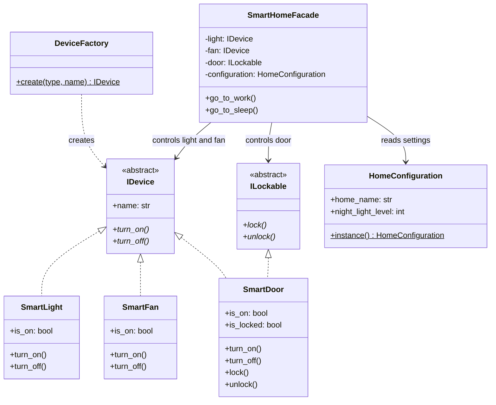

# Phân tích và thiết kế - Smart Home Mini

> Tài liệu này mô tả thiết kế và cách các lớp thiết bị, Factory, Singleton và Facade phối hợp với nhau.

## 1. Phạm vi

Chương trình điều khiển đèn, quạt và cửa. Đèn và quạt có thể bật/tắt; cửa có thể bật/tắt theo abstraction chung và có hành vi riêng khóa/mở khóa. Hai chế độ thường dùng là Đi làm và Đi ngủ.

Đề minh họa bằng C#. Bài này dùng Python, thống nhất với các bài OOP tuần trước. `IDevice` và `ILockable` được mô hình bằng lớp trừu tượng `ABC`; lỗi loại thiết bị không hỗ trợ được biểu diễn bằng `ValueError`.

## 2. Danh sách lớp

| Lớp | Trách nhiệm | Quan hệ |
|---|---|---|
| `IDevice` | Hợp đồng chung bật/tắt và tên thiết bị | Abstraction của các thiết bị |
| `ILockable` | Hợp đồng khóa/mở khóa | Abstraction hành vi riêng của cửa |
| `SmartLight` | Lưu và in trạng thái đèn | Cài đặt `IDevice` |
| `SmartFan` | Lưu và in trạng thái quạt | Cài đặt `IDevice` |
| `SmartDoor` | Lưu trạng thái nguồn và khóa cửa | Cài đặt `IDevice`, `ILockable` |
| `DeviceFactory` | Tạo thiết bị từ chuỗi loại | Trả về `IDevice` |
| `HomeConfiguration` | Cấu hình dùng chung, gồm tên nhà và mức sáng ban đêm | Singleton |
| `SmartHomeFacade` | Điều phối các thiết bị theo chế độ | Nhận abstraction thiết bị và cấu hình |

## 3. UML lớp



## 4. Quy tắc hoạt động

- Factory bỏ khoảng trắng ở đầu/cuối và không phân biệt hoa thường khi nhận `light`, `fan`, `door`; loại khác phát sinh `ValueError`.
- Cấu hình Singleton được truy cập qua `HomeConfiguration.instance()`. Việc khởi tạo được bảo vệ bằng khóa để tránh tạo hai instance khi nhiều luồng gọi lần đầu đồng thời.
- `go_to_work()` tắt đèn, tắt quạt rồi khóa cửa.
- `go_to_sleep()` tắt quạt, khóa cửa, bật đèn và hiển thị mức sáng đêm lấy từ cấu hình.
- Facade nhận các abstraction và cho phép truyền cấu hình vào lúc khởi tạo, giúp kiểm thử độc lập hơn.

## 5. Kết quả kiểm tra

Các kiểm tra trong `tests/test_devices.py` bao phủ Factory, Singleton, chế độ Đi làm và chế độ Đi ngủ. Chạy:

```bash
python -m unittest discover -s tests -v
```

## 6. Câu hỏi phản biện

1. **Factory che giấu gì?** Quyết định ánh xạ chuỗi loại sang constructor cụ thể và chi tiết khởi tạo.
2. **Singleton đảm bảo gì và có rủi ro nào?** Nó cung cấp cùng một đối tượng cấu hình. Trạng thái toàn cục có thể làm các lần chạy phụ thuộc nhau và khiến kiểm thử kém cô lập.
3. **Facade khác Factory thế nào?** Factory tạo đối tượng; Facade gom thao tác trên các đối tượng đã tạo thành API mức cao.
4. **Bỏ Facade thì client phải biết gì?** Client phải tham chiếu từng thiết bị, tự gọi đúng thứ tự thao tác cho từng chế độ và tự truy cập cấu hình ánh sáng.
5. **Khi thêm SmartCamera, cần sửa gì?** Thêm lớp camera và cập nhật `DeviceFactory`; facade chỉ cần sửa nếu chế độ hiện tại cần camera.
